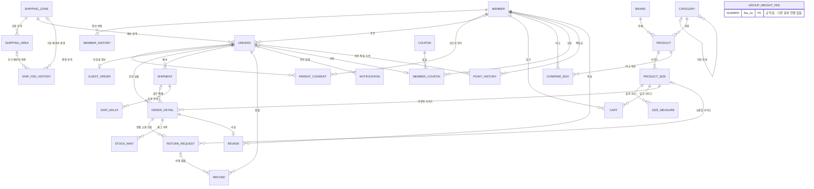
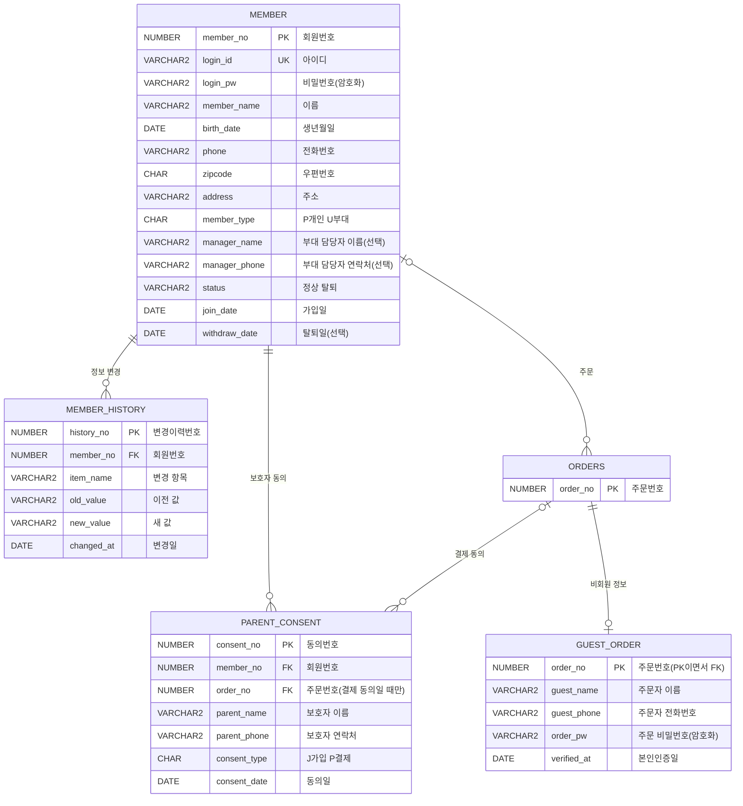
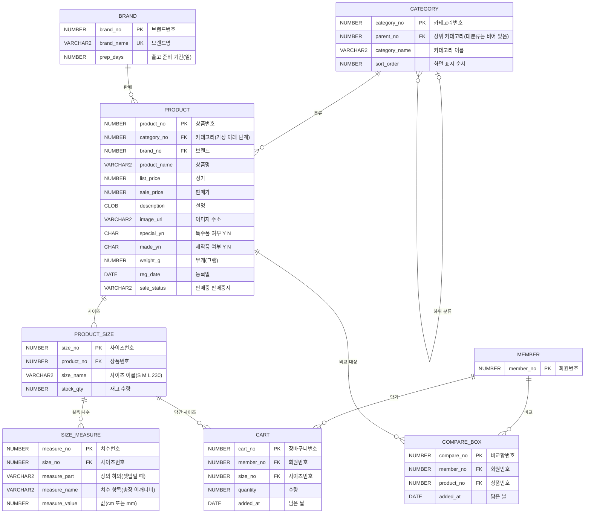
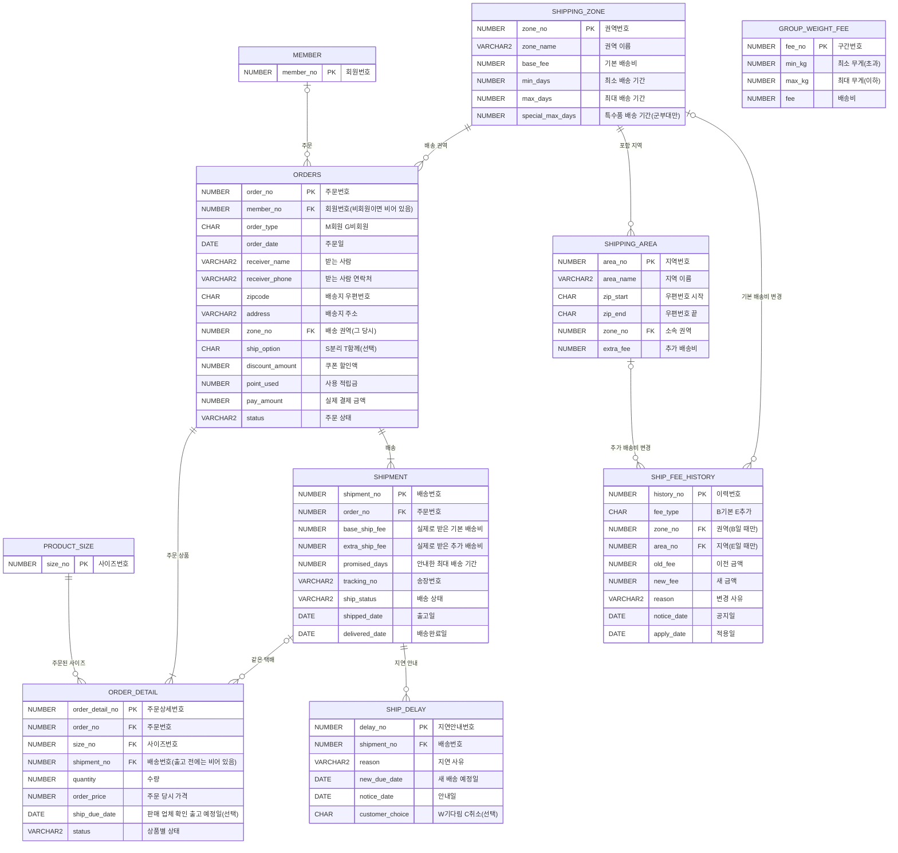
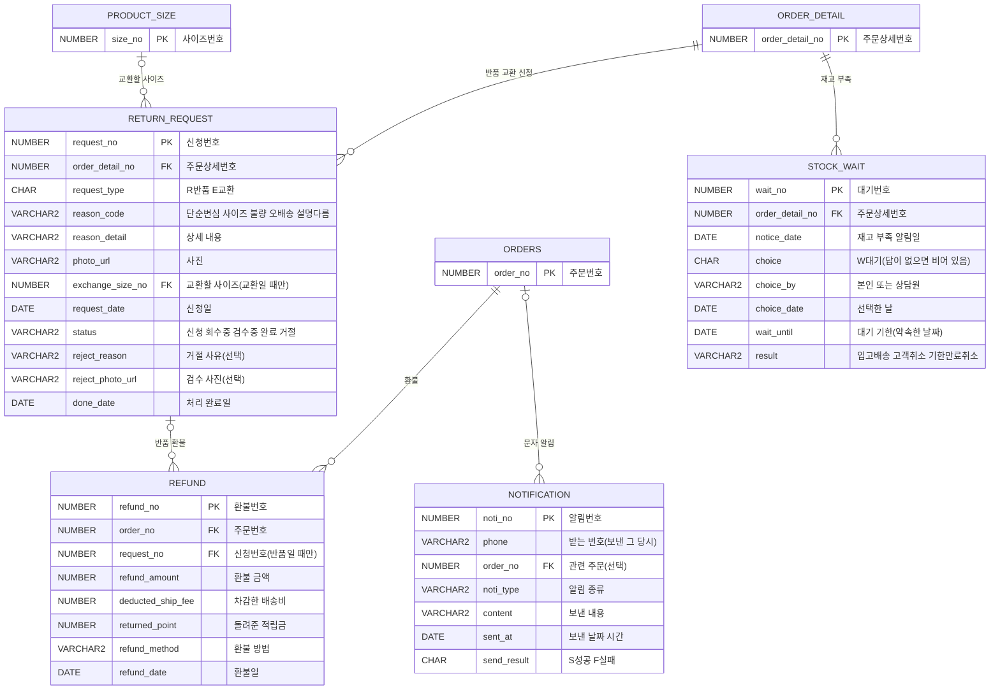
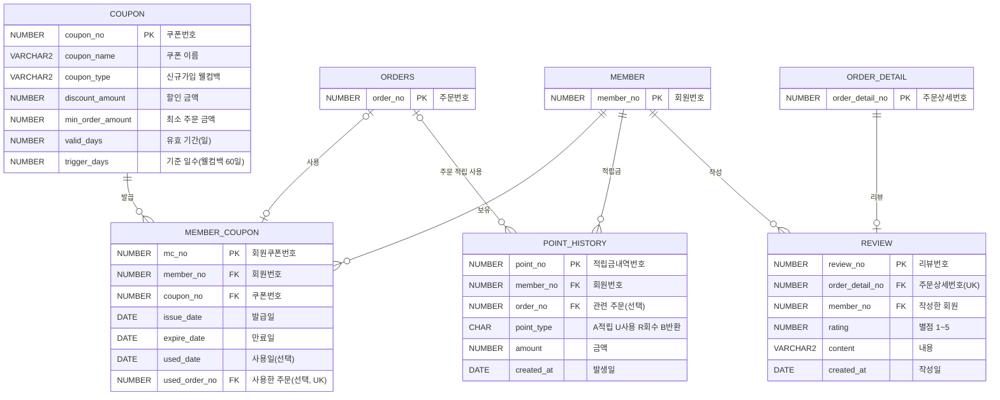

# 03. 의류 쇼핑몰 ERD 설계도

- 기준 문서: `01_요구사항.md`
- 대상 DB: Oracle 21c XE
- 표 개수: **27개** (5개 묶음)
- 이 파일은 ERDCloud에 옮겨 그릴 때 보는 **설계도**이다. 그림(Mermaid)과 표 정리가 함께 들어 있다.

## 읽는 법

| 기호 | 뜻 |
|---|---|
| **PK** | 기본키. 한 줄을 딱 하나로 구별하는 번호 |
| **FK** | 외래키. 다른 표의 PK를 적어 둔 칸(주소) |
| **UK** | 중복 금지(UNIQUE) |
| NULL 허용 = **선택** | 비어 있어도 되는 칸 |

Mermaid 관계선 기호

| 기호 | 뜻 |
|---|---|
| `\|\|--o{` | 1 : 0개 이상 (1:N) |
| `\|\|--\|{` | 1 : 1개 이상 |
| `\|o--o{` | 0 또는 1 : 0개 이상 (부모가 없을 수도 있음, FK 선택) |
| `\|\|--o\|` | 1 : 0 또는 1 (1:1) |

## 정한 것

- 상품 하나는 카테고리 **하나에만** 넣는다. (요구사항 4번, 상품 표에 category_no 칸 하나)
- 계산할 수 있는 값(나이, 할인율, 적립금 잔액, 주문 총 무게, 마지막 주문일)은 저장하지 않는다.
- 그 당시의 사실(주문 당시 가격, 실제로 낸 배송비, 약속한 배송 기간)은 저장한다.
- Y/N 값은 `CHAR(1)` + `CHECK (x IN ('Y','N'))`로 저장한다.

## 묶음 한눈에 보기

| 묶음 | 표 (논리 이름 / 물리 이름) | ERDCloud 색 (예시) |
|---|---|---|
| ① 회원 | 회원 MEMBER, 회원변경이력 MEMBER_HISTORY, 보호자동의 PARENT_CONSENT, 비회원주문정보 GUEST_ORDER | 파랑 |
| ② 상품 | 카테고리 CATEGORY, 브랜드 BRAND, 상품 PRODUCT, 상품사이즈 PRODUCT_SIZE, 사이즈치수 SIZE_MEASURE, 장바구니 CART, 비교함 COMPARE_BOX | 초록 |
| ③ 주문·배송 | 주문 ORDERS, 주문상세 ORDER_DETAIL, 배송 SHIPMENT, 배송권역 SHIPPING_ZONE, 배송지역 SHIPPING_AREA, 배송비변경이력 SHIP_FEE_HISTORY, 배송지연안내 SHIP_DELAY, 단체중량배송비 GROUP_WEIGHT_FEE | 주황 |
| ④ 취소·반품 | 반품교환신청 RETURN_REQUEST, 환불 REFUND, 재고부족대기 STOCK_WAIT, 알림발송기록 NOTIFICATION | 빨강 |
| ⑤ 혜택·리뷰 | 쿠폰 COUPON, 회원쿠폰 MEMBER_COUPON, 적립금내역 POINT_HISTORY, 리뷰 REVIEW | 보라 |

---

## 0. 전체 관계도 (표 이름만)

칸은 빼고 표와 관계선만 그린 큰 그림이다. 중심은 **주문(ORDERS)**과 **주문상세(ORDER_DETAIL)**이다.

---

## ① 회원 묶음

| 표 | 핵심 설명 |
|---|---|
| MEMBER | 주민등록번호는 저장하지 않는다(개인정보보호법). 나이는 birth_date로 계산. 적립금 잔액은 적립금내역의 합계로 계산하므로 저장하지 않는다. |
| PARENT_CONSENT | 가입 동의는 order_no가 비어 있고, 결제 동의는 order_no를 채운다. |
| GUEST_ORDER | 주문과 **1:1**. order_no가 PK이면서 동시에 ORDERS를 가리키는 FK이다. |

---

## ② 상품 묶음

| 표 | 핵심 설명 |
|---|---|
| CATEGORY | **자기 참조**. parent_no가 같은 표의 category_no를 가리킨다. 대분류 > 중분류 > 소분류를 표 하나로 만든다. 단계(depth)는 `CONNECT BY`로 계산하므로 저장하지 않는다. |
| PRODUCT | 할인율은 정가와 판매가로 계산하므로 저장하지 않는다. |
| SIZE_MEASURE | 치수 항목을 칸이 아니라 **줄**로 저장한다. 상의는 4줄, 신발은 2줄처럼 필요한 항목만 저장할 수 있다(요구사항 5-1). |
| CART | 회원 N : 상품사이즈 M을 잇는 **연결 표**. (member_no, size_no)는 중복 금지. 같은 걸 또 담으면 수량만 늘린다. |
| COMPARE_BOX | 회원 N : 상품 M을 잇는 **연결 표**. (member_no, product_no)는 중복 금지. 이름이 COMPARE이면 헷갈리므로 COMPARE_BOX로 지었다. |

---

## ③ 주문·배송 묶음

| 표 | 핵심 설명 |
|---|---|
| ORDERS | 표 이름 `ORDER`는 오라클 예약어라 `ORDERS`로 지었다. 상품 합계는 주문상세로 계산하지만, **실제 결제 금액**은 그 당시의 사실이라 저장한다. |
| ORDER_DETAIL | 주문 N : 상품사이즈 M을 잇는 **연결 표**. 쇼핑몰 설계의 핵심. order_price는 나중에 가격이 바뀌어도 그대로 남는 주문 당시 가격이다. |
| SHIPMENT | 함께 배송이면 1건, 분리 배송이면 2건. 반품 기간 7일은 이 표의 delivered_date부터 센다. |
| SHIP_FEE_HISTORY | zone_no와 area_no 중 **하나만** 채운다(CHECK로 강제). |
| SHIP_DELAY | 분리 배송 중 한 택배만 늦어질 수 있으므로 주문이 아니라 **배송**을 가리킨다. |
| GROUP_WEIGHT_FEE | 부대 단체 주문 배송비 규칙 표. 다른 표를 가리키지 않는다. |

---

## ④ 취소·반품 묶음

| 표 | 핵심 설명 |
|---|---|
| RETURN_REQUEST | 주문 전체가 아니라 **주문상세(상품 1개)** 단위로 신청한다(16-4). 교환이면 exchange_size_no로 바꿀 사이즈를 가리킨다. |
| REFUND | 취소, 재고부족취소, 반품 모두 환불이 생기므로 주문을 가리킨다. 반품으로 인한 환불일 때만 request_no를 채운다. |
| STOCK_WAIT | order_no는 넣지 않는다. 주문상세를 따라가면 알 수 있기 때문이다. |
| NOTIFICATION | 재고 부족, 배송 지연, 웰컴백 쿠폰 문자를 한 표에 모은다. 번호를 바꾼 회원이 있어도 그때 보낸 번호가 남는다. |

---

## ⑤ 혜택·리뷰 묶음

| 표 | 핵심 설명 |
|---|---|
| COUPON | 60일 같은 바뀔 수 있는 규칙 값을 trigger_days에 저장한다(10-10). |
| MEMBER_COUPON | 쿠폰 N : 회원 M을 잇는 **연결 표**. used_order_no에 UNIQUE를 붙여 **주문 1건에 쿠폰 1장**만 쓰게 한다(10-1). expire_date는 발급 당시 유효 기간으로 정해진 약속이므로 저장한다. |
| POINT_HISTORY | 회원의 적립금 잔액 = 이 표의 합계(적립 + 반환 − 사용 − 회수). |
| REVIEW | 상품이 아니라 **주문상세**를 가리킨다. 산 상품에만, 한 번만(UNIQUE) 쓸 수 있다. |

---

## 아직 정하지 않은 것

- 재고 부족 답변 기한 **2일**, 대기 최대 **30일**, 배송비 변경 사전 공지 **7일** 같은 규칙 값을 어느 표에 저장할지 정해야 한다.
- 단체 주문의 "50kg 초과는 10kg마다 3,000원 추가" 규칙을 GROUP_WEIGHT_FEE 표에 어떻게 넣을지 정해야 한다.
- 고객센터 상담원 정보를 표로 관리할지 정해야 한다. (지금은 STOCK_WAIT.choice_by에 글자로 저장한다.)
