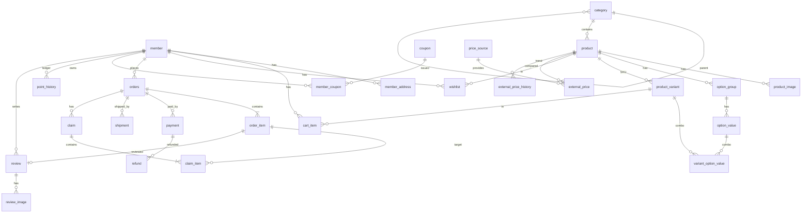

# 쇼핑몰 DB 설계

단일 판매자 쇼핑몰 / MySQL 8.0.16+ 기준 (PostgreSQL로도 옮기기 쉬운 타입 위주)

| 파일 | 내용 |
|---|---|
| `schema.sql` | 테이블 26개 + 최저가 비교 뷰 |
| `seed.sql` | 샘플 데이터 |
| `examples.sql` | 주문 트랜잭션, 최저가 조회, 정합성 점검 쿼리 |

## 실행
```powershell
# 최초 1회: 컨테이너 생성 (이미 있으면 docker start shop-db)
docker run -d --name shop-db -e MYSQL_ROOT_PASSWORD=root -p 3306:3306 mysql:8.0 --character-set-server=utf8mb4 --collation-server=utf8mb4_0900_ai_ci

# 기동 후 (20~30초) - 프로젝트 루트에서. 한글 깨짐 방지를 위해 파일을 복사해서 실행
docker cp db/. shop-db:/sql/
docker exec shop-db sh -c "mysql -uroot -proot --default-character-set=utf8mb4 < /sql/schema.sql"
docker exec shop-db sh -c "mysql -uroot -proot --default-character-set=utf8mb4 < /sql/seed.sql"
docker exec shop-db sh -c "mysql -uroot -proot --default-character-set=utf8mb4 -t < /sql/examples.sql"
```
`schema.sql`은 기존 테이블을 지우고 다시 만들므로, 언제든 처음 상태로 초기화할 수 있습니다.

접속 정보 (DBeaver, MySQL Workbench 등): `localhost:3306`, 사용자 `root`, 비밀번호 `root`, DB `shoppingmall`

## ERD


## 핵심 설계 포인트

1. **상품 vs SKU 분리** — `product`는 상품 정보, `product_variant`는 옵션 조합별 판매단위(재고·추가금).
   옵션은 `option_group`(색상) → `option_value`(블랙) → `variant_option_value`로 SKU에 연결.
   최종 가격 = `product.sale_price + product_variant.extra_price`.
2. **주문 스냅샷** — `order_item`에 상품명·옵션·단가를, `orders`에 배송지를 복사 저장.
   나중에 상품 가격이나 회원 주소가 바뀌어도 주문 내역은 그대로.
3. **금액은 원 단위 정수** — `orders`에는 `pay_amount = 상품합계 + 배송비 - 쿠폰 - 적립금` CHECK 제약.
4. **적립금은 원장(ledger)** — `point_history`가 진실의 원천, `member.point_balance`는 조회용 캐시.
   `examples.sql`의 정합성 점검 쿼리로 둘이 일치하는지 확인.
5. **부분 취소/반품** — `claim`(요청 단위) + `claim_item`(어떤 주문상품을 몇 개) + `refund`(환불).
   `order_item.status`로 상품별 상태 관리.
6. **리뷰는 구매자만** — `review.order_item_id` UNIQUE → 주문상품 1건당 리뷰 1개.
7. **최저가 비교** — 수집 배치가 출처별 최신가를 `external_price`에 UPSERT, 동시에 `external_price_history`에 누적.
   `v_product_price_compare` 뷰로 "우리 판매가 vs 시장 최저가(배송비 포함)"를 바로 조회.
   매칭 키는 `product.model_code`. (우리 쪽 배송비는 비교에 포함하지 않음 — 필요하면 뷰에 추가)
8. **상태값은 VARCHAR 코드** — ENUM보다 변경·이식이 쉬움. 허용값은 애플리케이션 상수로 관리.

## 트랜잭션 규칙 (주문 결제 시)
한 트랜잭션 안에서:
1. 재고 차감 — `UPDATE ... SET stock_qty = stock_qty - ? WHERE id = ? AND stock_qty >= ?` (영향 0행이면 롤백)
2. `orders` / `order_item` 생성 (스냅샷)
3. 쿠폰 사용 — `WHERE status = 'UNUSED'` 조건부 업데이트로 중복 사용 방지
4. 적립금 차감 + `point_history` 기록
5. `payment` 기록, 장바구니 비우기

실제 서비스에서는 PG 결제 승인 전 `PENDING` 주문을 만들고, PG 승인 콜백에서 `PAID`로 바꾸는 2단계 흐름을 권장.
구매확정(`CONFIRMED`) 시점에 구매 적립금(`EARN_ORDER`)을 지급하면 반품 시 회수 처리가 단순해짐.

## 나중에 확장할 때
- 비회원 주문: `orders.member_id` NULL 허용 + 주문 비밀번호 컬럼
- 소셜 로그인: `member_social(member_id, provider, provider_user_id)`
- 상품 Q&A, 재입고 알림, 최저가 하락 알림(`price_alert`)
- 매출 통계용 일별 집계 테이블
